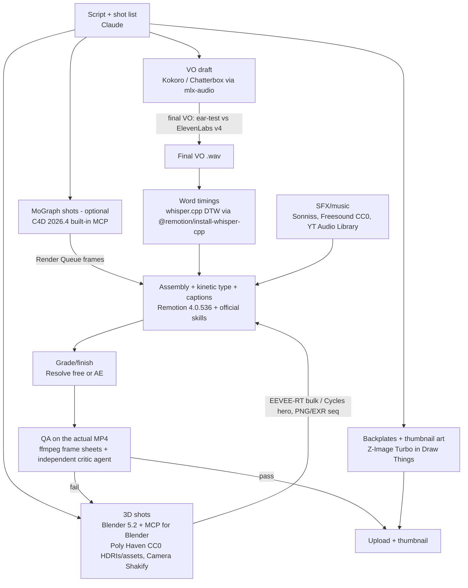

# Native toolchain for top-tier explainers — research, 16 Oct 2026

Machine: M1 Pro (16-core GPU, Metal 4), 32 GB, 95 GB free, macOS 26.1. Blender 5.2.2 LTS, AE 2025/26, C4D 2025/26, Draw Things, Remotion 4.0.532 installed.
Method: GitHub stats pulled live via GraphQL (16–17 Oct 2026). Leaderboards read live in the browser. One render benchmark run on this Mac. Nothing installed.
★ = GitHub stars. "Last" = last commit on the default branch. Vendor claims are labelled as vendor claims.

---

## (a) Ranked recommendations (one screen)

| # | Tool | Job | Why (evidence) | Cost | Licence | Install | Risk / vetting |
|---|---|---|---|---|---|---|---|
| 1 | **Blender 5.2.2 LTS** (installed): EEVEE for volume, Cycles for hero shots | 3D hero shots | **Measured on this Mac:** 1080p product shot, EEVEE+RT **3.6 s**/frame vs Cycles 128 spp+OIDN **16.8 s** ([bench](#a2-blender-quality-stack)). LTS to Jul 2028 ([blender.org](https://www.blender.org/releases/5-2/)) | £0 | GPL | done | None |
| 2 | **MCP for Blender** (ahujasid) | Claude drives live Blender, checks its own work | [31.2k★, last 2026-10-06, 27 issues](https://github.com/ahujasid/mcp-for-blender). Adds a `look` tool (viewport, camera, multi-angle and anim-strip renders), scene query, Poly Haven/Sketchfab/Poly Pizza import | £0 (paid 3D-gen tier optional) | MIT | `claude mcp add blender -e DISABLE_TELEMETRY=true -e BLENDER_MCP_SAFE_MODE=1 -- uvx mcp-for-blender` then `uvx mcp-for-blender install-addon` | 4 CVEs in 2026, all closed/fixed by 20 Jul ([#201](https://github.com/ahujasid/mcp-for-blender/issues/201) [#202](https://github.com/ahujasid/mcp-for-blender/issues/202) [#203](https://github.com/ahujasid/mcp-for-blender/issues/203) [PR #258](https://github.com/ahujasid/mcp-for-blender/pull/258)). Anonymous telemetry is ON by default. Runs arbitrary Python. Skip the `curl \| sh` installer |
| 3 | **Remotion 4.0.536 + official Agent Skills** | Typography, 2D, captions, final assembly | [Remotion 64.6k★, 2.26M npm downloads/wk](https://github.com/remotion-dev/remotion). [Skills 5.2k★, official, last 2026-10-16](https://github.com/remotion-dev/skills) | £0 for ≤3 employees | [Remotion Licence](https://github.com/remotion-dev/remotion/blob/main/LICENSE.md) | `npx skills add remotion-dev/skills` | A company licence is needed once you have more than 3 employees |
| 4 | **Cinema 4D 2026.4 built-in MCP** (official, Maxon) | MoGraph, Takes, Render Queue driven by Claude | Ships in 2026.4. Off by default. Token auth, per-tool-group checkboxes, separate Python toggle, local audit log ([DP](https://digitalproduction.com/2026/10/01/cinema-4d-2026-4-mcp/), [Architosh](https://architosh.com/2026/10/whats-in-maxons-new-cinema-4d-mcp-server/)) | Included with your C4D | Proprietary | Maxon App → update to 2026.4 → Preferences → MCP | Officially Claude Desktop/ChatGPT; Claude Code not confirmed. Redshift GPU needs Maxon One/Redshift sub ([Maxon](https://www.maxon.net/en/cinema-4d/features/redshift-everywhere)) |
| 5 | **mlx-audio** → Kokoro-82M / Chatterbox | Local voice-over (drafts and volume) | [mlx-audio 8.1k★, last 2026-10-16](https://github.com/Blaizzy/mlx-audio). Kokoro is **#2 commercial-OK open model** on AA (1061 Elo) ([AA](https://artificialanalysis.ai/text-to-speech/leaderboard/provider-voice)) | £0 | MIT / Apache-2.0 (Kokoro) / MIT (Chatterbox) | `uv tool install --force mlx-audio --prerelease=allow` | Still about 270 Elo below ElevenLabs v4 ([A5](#a5-local-voice-vs-elevenlabs)). Chatterbox output carries an inaudible [PerTh watermark](https://github.com/resemble-ai/chatterbox) |
| 6 | **whisper.cpp via `@remotion/install-whisper-cpp`** | Word-level captions | [whisper.cpp 54.4k★, runs on Metal](https://github.com/ggml-org/whisper.cpp). Remotion's `transcribe()` with `tokenLevelTimestamps` uses DTW, and its docs recommend it for accurate timing ([docs](https://www.remotion.dev/docs/install-whisper-cpp/transcribe)) | £0 | MIT | `npm i -E @remotion/install-whisper-cpp@<your remotion version>` | Pin the same version as `remotion` |
| 7 | **Camera Shakify** | Handheld and camera-shake realism | [1.27k★](https://github.com/EatTheFuture/camera_shakify). v0.5+ needs Blender 4.4+. Shake data is CC0 ([extension page](https://extensions.blender.org/add-ons/camera-shakify/)) | £0 | GPL-3 code, CC0 data | Blender → Get Extensions → "Camera Shakify" | None |
| 8 | **Sonniss GDC 2026 + YouTube Audio Library + Freesound CC0** | SFX and music beds | Audio Library tracks don't trigger Content ID and are monetizable ([YouTube](https://support.google.com/youtube/answer/3376882)). Sonniss 2026: 7.47 GB, 17 vendors, no attribution ([Rekkerd](https://rekkerd.org/sonniss-releases-gdc-2026-game-audio-bundle/)) | £0 | Royalty-free / CC0 | Download (gdc.sonniss.com, YouTube Studio, freesound.org) | Sonniss bans AI training ([GFS](https://gamefromscratch.com/sonniss-27-5gb-sound-effect-giveaway-at-gdc-2024/)). CC tracks need credit in the description |
| 9 | **Z-Image Turbo in Draw Things** | Thumbnails, backplates | Commercial-safe open image model. AA 935 vs FLUX.2-dev anchor 1000 ([AA](https://artificialanalysis.ai/image/leaderboard/text-to-image)). Apache-2.0, 6.2B params ([HF](https://huggingface.co/Tongyi-MAI/Z-Image-Turbo)). Draw Things supports Z Image ([releases](https://github.com/drawthingsai/draw-things-community/releases)) | £0 | Apache-2.0 | Model picker inside Draw Things | Avoid Qwen-Image-2.1 / Ideogram 4 / FLUX.2-dev: non-commercial ([A8](#thumbnail-models--licence-traps)) |
| 10 | **HyperFrames** (HeyGen) | Agent-native HTML/GSAP motion graphics | [65.2k★, 5.9k forks, 811k npm/wk, created 2026-03-10](https://github.com/heygen-com/hyperframes). 21 skills incl. `/faceless-explainer` and `/motion-graphics` | £0 | Apache-2.0 | `claude plugin marketplace add heygen-com/hyperframes` | Young (v0.8.x). Telemetry is on, disable with `HYPERFRAMES_NO_TELEMETRY=1`. Overlaps with Remotion, so A/B one scene first |
| 11 | **Stable Audio 3** (Small SFX / Medium) | Generated SFX and music | Trained on licensed data (AudioSparx + Freesound). Medium scores 996 vs anchor 1000 on AA Instrumental ([Stability](https://stability.ai/news-updates/meet-stable-audio-3-the-model-family-built-for-artistic-experimentation-with-open-weight-models), [AA](https://artificialanalysis.ai/music/leaderboard/instrumental)) | £0 if revenue < $1M | Stability Community | HF (gated) | Sample code only selects CUDA or CPU, so MPS is untested ([HF](https://huggingface.co/stabilityai/stable-audio-3-medium)) |
| 12 | **DaVinci Resolve 21** (free; Studio $295) | Grade, Fusion, finishing | Free tier: UHD/60, Fusion, Fairlight. **Studio 21.1 adds a native MCP**; Python scripting moved to Studio-only ([CineD](https://www.cined.com/davinci-resolve-21-1-released-ai-assistant-integration-via-mcp-individual-hdr-trims-and-python-scripting-moves-to-studio/)) | £0 / $295 | Proprietary | blackmagicdesign.com | Free tier is not Claude-operable since 21.1 |
| 13 | **LTX-2.5 via ltx-2-mlx or Draw Things** | Occasional AI b-roll | Best commercial-OK open video model: 950 vs Kling 3.0 1000 vs Veo 3.1 967 ([AA](https://artificialanalysis.ai/video/leaderboard/text-to-video)). Free under $10M revenue ([HF](https://huggingface.co/Lightricks/LTX-2.5)) | £0 | LTX-2.x Community | `ltx-2-mlx` ([129★](https://github.com/dgrauet/ltx-2-mlx)) | **Estimate ~15–30 min per 5 s clip on M1 Pro** ([A4](#a4-local-ai-video-on-m1-pro-32-gb)). Not hero-shot quality |
| 14 | **ACE-Step 1.5** | Local songs | [13.7k★, MIT, Mac MLX scripts](https://github.com/ace-step/ACE-Step-1.5). Vendor claims quality "between Suno v4.5 and v5" | £0 | MIT | Mac portable package | Not on any independent leaderboard. Ear-test before use |
| 15 | **aerender + ExtendScript (`DoScriptFile`)** | Claude-driven After Effects | aerender is Adobe's CLI ([Adobe](https://helpx.adobe.com/after-effects/using/automated-rendering-network-rendering.html)). AppleScript `DoScriptFile` runs a .jsx ([AE scripting guide](https://ae-scripting.docsforadobe.dev/introduction/overview/)) | In your CC plan | Proprietary | Already installed | No official AE MCP. The biggest community one has 754★ and was last updated Apr 2026 ([repo](https://github.com/Dakkshin/after-effects-mcp)) |

**3 biggest quality levers:**
1. **Light and render path.** Cycles+OIDN for hero shots (correct glass and reflections), EEVEE-RT for volume. Each Cycles frame costs about 4.6× the EEVEE-RT time on this Mac.
2. **Narrator voice.** This is the largest measured gap: the AA Elo gap implies listeners prefer ElevenLabs v4 over the best commercial-OK open model about **82%** of the time.
3. **Motion sync.** Word-timed captions, camera shake and SFX hits locked to timestamps, built with Remotion skills, whisper DTW, Shakify and Sonniss.

---

## (b) Pipeline: one film, script → upload (winners only)

---

## (c) Install now / later / skip

### Install now (free, safe, high impact)

| # | Item | One-line evidence | Vetting note |
|---|---|---|---|
| 1 | MCP for Blender | [31.2k★, MIT, active](https://github.com/ahujasid/mcp-for-blender); `look` tool lets Claude see renders | Use `SAFE_MODE=1` and `DISABLE_TELEMETRY=true`. Leave Sketchfab and 3D-gen toggles off. Work on copies |
| 2 | Remotion Agent Skills | [Official, 5.2k★](https://github.com/remotion-dev/skills); you already run Remotion | None |
| 3 | C4D → 2026.4 + built-in MCP | Official Maxon MCP: token, tool groups, Python toggle, audit log ([DP](https://digitalproduction.com/2026/10/01/cinema-4d-2026-4-mcp/)) | Leave Python off and enable only the render/MoGraph groups |
| 4 | mlx-audio (Kokoro, Chatterbox, Qwen3-ForcedAligner) | One MIT package covers local TTS and word alignment on MLX ([README](https://github.com/Blaizzy/mlx-audio)) | Models download from HF on first use |
| 5 | @remotion/install-whisper-cpp | Remotion-native captions. DTW gives "actually accurate timings" ([docs](https://www.remotion.dev/docs/install-whisper-cpp/transcribe)) | Pin the version |
| 6 | Camera Shakify | [1.27k★, CC0 shake data](https://github.com/EatTheFuture/camera_shakify) | None |
| 7 | Sonniss GDC 2026 + YT Audio Library + Freesound CC0 | Royalty-free with no attribution, or Content-ID safe ([YouTube](https://support.google.com/youtube/answer/3376882), [Rekkerd](https://rekkerd.org/sonniss-releases-gdc-2026-game-audio-bundle/)) | Keep download proof |
| 8 | Z-Image Turbo (in Draw Things) | Apache-2.0, AA 935 ([HF](https://huggingface.co/Tongyi-MAI/Z-Image-Turbo), [AA](https://artificialanalysis.ai/image/leaderboard/text-to-image)) | Download it in-app |

### Later (after a 1-scene test)

| Item | Why wait |
|---|---|
| HyperFrames | Strong traction and Apache-2.0, but it's a 2nd framework. A/B one kinetic-type scene against Remotion ([repo](https://github.com/heygen-com/hyperframes)) |
| Stable Audio 3 Small-SFX / Medium | Clean training data, but MPS is unverified ([HF](https://huggingface.co/stabilityai/stable-audio-3-medium)) |
| ACE-Step 1.5 / MiniMax Music 3 (mlx-audio) | MiniMax Music 3 is the top open-weights music model (AA Instrumental anchor 1000). Its licence requires showing "MiniMax-Music3" in a commercial product UI, and >$20M revenue needs authorisation ([licence](https://huggingface.co/MiniMaxAI/MiniMax-Music3)). Ear-test both |
| LTX-2.5 b-roll (ltx-2-mlx / Draw Things) | Run a 10-minute timing test first. Today's M1 Pro figure is an estimate |
| Resolve Studio ($295) | Only if you want native MCP plus Speed Warp, Magic Mask and NR ([Post Flow](https://thepostflow.com/post-production/video-editing/resolve-studio-vs-free/)) |
| Blender Lab official MCP | Official, v1.0.3, Blender 5.1+. But it runs LLM code "without any guards" and Blender advises a VM ([blender.org](https://www.blender.org/lab/mcp-server/)) |
| kumoproductions/mcp-aftereffects | Active (last 2026-10-16) but [120★, created Aug 2026](https://github.com/kumoproductions/mcp-aftereffects). aerender plus `DoScriptFile` is enough until it matures |
| claude-video-vision | Lets Claude "watch" MP4s, with local whisper mode available ([1.4k★](https://github.com/jordanrendric/claude-video-vision)). Mostly duplicates ffmpeg frame sheets + Read |
| three-gpu-pathtracer / webgpu-claude-skill | Path-traced or TSL looks inside three.js ([1.9k★](https://github.com/gkjohnson/three-gpu-pathtracer), [1.25k★](https://github.com/dgreenheck/webgpu-claude-skill)). Only needed if 3D stays in code |
| ComfyUI + artokun/comfyui-mcp | Only if Draw Things lacks a needed model ([ComfyUI 137.9k★](https://github.com/Comfy-Org/ComfyUI), [MCP 829★](https://github.com/artokun/comfyui-mcp)) |

### Skip (with reason)

| Item | Reason (evidence) |
|---|---|
| Unreal 5.8 (+ its MCP) | M1 Pro lacks Nanite, VSM, HW-RT Lumen and MegaLights (all need M2+) ([Epic](https://dev.epicgames.com/documentation/unreal-engine/macos-development-requirements-for-unreal-engine)). Install is 40–80 GB typical, users report 114–115 GB ([guide](https://practicetestgeeks.com/unreal/unreal-engine-download), [forum](https://forums.unrealengine.com/t/size-of-ue5/666089)), plus Xcode 26, against 95 GB free. MCP is experimental with no auth ([Epic](https://dev.epicgames.com/documentation/unreal-engine/unreal-mcp-in-unreal-editor?lang=en-US)) |
| MiniMax H3 (open video #1, 1159) | UK/EU/US/KR use needs a separate application ([HF](https://huggingface.co/MiniMaxAI/MiniMax-H3)). 33B params. A measured self-host took 2× RTX 5090 and ~384 GB host RAM for 559.67 s (~9.3 min) per 5 s clip at 1344×768 ([Spheron](https://www.spheron.network/blog/deploy-minimax-h3-gpu-cloud/)) |
| Qwen-Image-2.1, Ideogram 4, FLUX.2-dev / klein-9B | Non-commercial licences ([Qwen](https://huggingface.co/Qwen/Qwen-Image-2.1), [Ideogram](https://huggingface.co/ideogram-ai/ideogram-4-fp8), [FLUX.2 klein-9B](https://huggingface.co/black-forest-labs/FLUX.2-klein-9B)) |
| Video2X | Windows and Linux only ([README](https://github.com/k4yt3x/video2x)) |
| FILM (Google) | Archived, last commit 2023 ([repo](https://github.com/google-research/frame-interpolation)) |
| Theatre.js | Last commit Apr 2024 ([repo](https://github.com/theatre-js/theatre)) |
| Motion Canvas | Last release Dec 2024, 6.1k npm/wk, against Remotion's 2.26M ([repo](https://github.com/motion-canvas/motion-canvas)) |
| MusicGen | Weights are CC-BY-NC ([README](https://github.com/facebookresearch/audiocraft)). Last of 19 on AA Instrumental (868) ([AA](https://artificialanalysis.ai/music/leaderboard/instrumental)) |
| WhisperX on Mac | Falls back to CPU on Apple Silicon ([report](https://github.com/attevon-llc/OpenTranscribe/issues/48)). whisper.cpp runs on Metal instead |
| Breeze TTS 2 / Fish Audio Drama 3 | Breeze: non-commercial and CUDA-only ([HF](https://huggingface.co/BreezeBlue/Breeze-TTS-2)). Drama 3: 35B MoE and the licence is unclear ([HF](https://huggingface.co/fishaudio/drama-3)) |
| Community davinci-resolve-mcp on free Resolve | Resolve 21.1 gates scripting to Studio ([README](https://github.com/samuelgursky/davinci-resolve-mcp)) |
| OpenMontage | AGPL. Mostly orchestrates paid APIs, and its free tier uses Piper TTS ([README](https://github.com/calesthio/OpenMontage)). 68.9k★ doesn't make up for that |
| Real-ESRGAN for our own renders | Last commit 2024, Mac binary from 2022 ([release](https://github.com/xinntao/Real-ESRGAN/releases/tag/v0.2.5.0)). Render at native resolution instead. Keep it only for legacy footage |

---

## (d) Honest gaps

- **No measured M1 Pro timings for LTX or Wan.** The 15–30 min per clip is scaled from an M3 Max figure. Needs a 10-minute local test.
- **The voice arenas disagree.** AA puts open models about 270 Elo below ElevenLabs v4. TTS Arena puts Chatterbox only 20 points below Eleven v3 (v4 isn't listed). An ear test on our own script is required.
- **Blender Lab MCP repo was behind a bot challenge**, so its tool list is unverified. Release dates (v1.0.0 27 Apr → v1.0.3 11 Sep 2026) come from [secondary coverage](https://www.strayspark.studio/blog/official-blender-mcp-server-comparison-2026).
- **C4D MCP with Claude Code is unconfirmed.** Officially it supports Claude Desktop only.
- **Channel toolchains are thinly documented.** Zack D Films comes from one freelancer's portfolio. LEMMiNO and Real Engineering: nothing public found.
- **MCP for Blender CVEs are sourced from a vendor blog.** I verified the GitHub issues and PR myself, but not the CVE records.
- **Star counts can be inflated.** HyperFrames, OpenMontage and ui-ux-pro-max (136.6k★) are new or anomalous. Fork and issue ratios look organic, but treat them with care.
- **No Content-ID data on AI-generated music.** Only library sources (YouTube Audio Library) are confirmed safe.
- **Benchmark scene is simple** (4 objects, 3 lights). Real shots will be slower. EEVEE glass also rendered dark without per-material raytraced transmission.

---

# Evidence by area

## A1. Claude-operable 3D and apps

| Option | Status / stats | What it adds over headless `blender -b -P` | Network / code exec |
|---|---|---|---|
| [MCP for Blender](https://github.com/ahujasid/mcp-for-blender) (renamed from blender-mcp; PyPI `mcp-for-blender`) | 31.2k★ · last 2026-10-06 · 27 issues / 25 PRs · MIT | `look` (viewport/camera/angles/frames, solid/rendered/wireframe), `get_scene_info`, `search_assets`/`import_asset`, `generate_3d`. A live session with no reloads | Arbitrary Python (`execute_blender_code`). Anonymous telemetry by default (install ID, tool name, timings, OS); content only if you opt in, and "may be used… to train AI models". Disable with `DISABLE_TELEMETRY=true`. Optional `BLENDER_MCP_SAFE_MODE=1` blocks file, network and subprocess access in scripts. Calls Poly Haven, Sketchfab, Poly Pizza, Tripo, Hunyuan3D and Rodin APIs |
| Same: security history | [#201 RCE via exec](https://github.com/ahujasid/mcp-for-blender/issues/201) (closed 25 Jun) · [#202 file read](https://github.com/ahujasid/mcp-for-blender/issues/202) and [#203 SSRF](https://github.com/ahujasid/mcp-for-blender/issues/203) (closed 19 Apr) · [PR #258 path-traversal write fix](https://github.com/ahujasid/mcp-for-blender/pull/258) (merged 20 Jul) · [#207 restrict exec](https://github.com/ahujasid/mcp-for-blender/issues/207) closed | n/a | CVE IDs per [StraySpark (vendor blog)](https://www.strayspark.studio/blog/is-blender-mcp-safe-security-guide-2026) |
| [Blender Lab MCP (official)](https://www.blender.org/lab/mcp-server/) | v1.0.3. Blender 5.1+. Secondary coverage links it to Anthropic's 28 Apr 2026 Blender connector ([Anthropic](https://www.anthropic.com/news/claude-for-creative-work)) | Python API access, docs lookup | "executes LLM generated code… without any guards". Blender recommends a VM |
| [C4D 2026.4 MCP (official)](https://architosh.com/2026/10/whats-in-maxons-new-cinema-4d-mcp-server/) | Built in, free, off by default | MoGraph, Takes, Render Queue, multipass prep | Local only by default. Token. Tool-group checkboxes. Python toggle. Audit log |
| [ttiimmaacc/cinema4d-mcp](https://github.com/ttiimmaacc/cinema4d-mcp) · [kumoproductions/mcp-cinema4d](https://github.com/kumoproductions/mcp-cinema4d) | 132★ (last 2026-03) · 26★ (last 2026-09) | Superseded by the official MCP | Socket plugin |
| After Effects | No official MCP. The Adobe Claude connector names Photoshop, Premiere and Express; AE isn't named ([Anthropic](https://www.anthropic.com/news/claude-for-creative-work)). UXP public beta is due by Nov 2026, with CEP disabled by default from Dec 2028 ([Adobe](https://blog.developer.adobe.com/en/publish/2026/09/investing-in-the-future-of-creative-cloud-extensibility-uxp-comes-to-our-flagship-applications)) | `aerender -project … -comp … -output …` ([Adobe](https://helpx.adobe.com/after-effects/using/automated-rendering-network-rendering.html)) plus `osascript` → `DoScriptFile x.jsx` ([guide](https://ae-scripting.docsforadobe.dev/introduction/overview/)) | Community MCPs: [Dakkshin 754★](https://github.com/Dakkshin/after-effects-mcp) (last Apr 2026), [kumoproductions 120★](https://github.com/kumoproductions/mcp-aftereffects); others under 100★ |
| DaVinci Resolve 21.1 | Native MCP is Studio-only (8 Sep 2026). Free tier lost Python scripting ([CineD](https://www.cined.com/davinci-resolve-21-1-released-ai-assistant-integration-via-mcp-individual-hdr-trims-and-python-scripting-moves-to-studio/), [DP](https://digitalproduction.com/2026/09/08/resolve-21-1-adds-mcp-and-finally-gets-presets/)) | Edit, organise and batch render | Studio $295 |
| Unreal 5.8 | Official MCP is experimental, at `127.0.0.1:8000/mcp` with no auth ([Epic](https://dev.epicgames.com/documentation/unreal-engine/unreal-mcp-in-unreal-editor?lang=en-US)) | n/a | **Skip on this Mac.** Needs Sonoma 14.5+ and Xcode 26.0+ (26.4 incompatible). 16 GB min / 32 GB recommended. Nanite and VSM need M2+ ([Epic](https://dev.epicgames.com/documentation/unreal-engine/macos-development-requirements-for-unreal-engine)) |

## A2. Blender quality stack

**Measured on this Mac** (Blender 5.2.2, Metal GPU, 1920×1080, red car-paint Suzanne + chrome cube + glass sphere, 3 area lights. Script and renders are in the session scratchpad, not committed):

| Engine / settings | s per frame | 60 s @30 fps (1,800 frames) |
|---|---|---|
| EEVEE 64 spp, no raytracing | **2.42** | 1.2 h |
| EEVEE 64 spp, screen-space raytracing | **3.62** | 1.8 h |
| Cycles Metal 128 spp + OIDN (GPU) | **16.75** | 8.4 h |
| Cycles Metal 512 spp + OIDN (GPU) | **37.86** | 18.9 h |
| First Cycles run (one-time Metal kernel compile) | +~100 s | n/a |

At this size, 128 and 512 spp with OIDN look almost identical. EEVEE's glass rendered dark without per-material raytraced transmission. Cycles gets glass and reflections right by default.

**Context: Blender Open Data, Blender 4.5, GPU medians** ([query](https://opendata.blender.org/benchmarks/query/?compute_type=METAL&compute_type=OPTIX&group_by=device_name&blender_version=4.5.0)):

| Device | Median score | Runs |
|---|---|---|
| **M1 Pro 16-core (this Mac)** | **483** | 44 |
| M1 Max 32-core | 955 | 50 |
| M3 Pro 18-core | 1,756 | 30 |
| M4 Pro 20-core | 2,568 | 123 |
| M4 Max 40-core | 5,267 | 124 |
| RTX 4090 (OptiX) | 11,061 | 527 |

So this Mac is about 23× slower than an RTX 4090 for Cycles.

| Item | Evidence | Licence / note |
|---|---|---|
| Colour | Blender 5.0 added ACES 1.3/2.0 view transforms, AgX HDR, per-file working space (ACEScg), and HDR display on Apple Silicon ([DP](https://digitalproduction.com/2025/09/02/blender-5-0-ships-built-in-aces-2-0-view-transform/), [It's FOSS](https://itsfoss.com/news/blender-5-0-release/)) | Keep AgX for SDR YouTube. ACES 2.0 is optional |
| Denoise | OIDN has been GPU-accelerated on Apple Silicon since 4.1 (macOS 13+) ([notes](https://wiki.blender.org/release_notes/4.1/cycles/)) | Built in |
| 5.2 LTS specifics | EEVEE screen-space RT overhaul (some scenes render darker), Thin Wall BSDF, Cycles texture cache ([notes](https://developer.blender.org/docs/release_notes/5.2/eevee/)). Remote asset libraries; Essentials gains online HDRIs and materials (needs "Allow Internet Access") ([notes](https://developer.blender.org/docs/release_notes/5.2/assets/)) | Built in |
| Poly Haven | All assets CC0 ([licence](https://polyhaven.com/license)). API is free for any purpose including commercial since [18 Jul 2026](https://github.com/Poly-Haven/Public-API/blob/master/ToS.md) (commit `4a6ceb9a64`). 521 models, **no vehicle category** (API) | Credit is only required inside software UI that surfaces the live API |
| BlenderKit free tier | Royalty-Free or CC0. Commercial use OK, no reselling the asset itself ([docs](https://www.blenderkit.com/docs/licenses/)) | Check per asset |
| Sketchfab | Free CC models still downloadable. CC-BY maps to Fab's CC licence; BY-SA and NC aren't migrated ([Epic](https://dev.epicgames.com/documentation/fab/migrating-assets-to-fab)) | Use CC0/CC-BY only, and credit CC-BY |
| Free cars | Poly Haven has none. Use BlenderKit free (RF) or Sketchfab CC0/CC-BY | Brand logos and trademarks are a separate risk. Prefer generic designs |
| MoGraph in Blender | No mature free C4D-style toolkit. New repos (HoloMoGraph, MoBlend) have 0★. Use Geometry Nodes, or C4D MoGraph via its MCP | n/a |
| Camera | [Camera Shakify](https://github.com/EatTheFuture/camera_shakify). [Rigacar](https://github.com/digicreatures/rigacar) is stale (2022) | n/a |
| How top channels build | Zack D Films (freelancer portfolio): Blender, Cascadeur, BlenderKit, After Effects, EmberGen, Flamenco, templated pipeline, 100+ shorts ([portfolio](https://supersets.chrisreillyportfolio.com/zackdfilms.php)). Kurzgesagt: AE + Illustrator ([Skillshare class](https://www.skillshare.com/en/classes/motion-graphics-with-kurzgesagt-part-1/631970755)). 3Blue1Brown: manim ([95.2k★](https://github.com/3b1b/manim)) | LEMMiNO and Real Engineering: not documented |

## A3. Code-built motion (typography, 2D, compositing)

| Tool | Stars · last · adoption | Strength | Licence |
|---|---|---|---|
| [Remotion](https://github.com/remotion-dev/remotion) | 64.6k★ · 2026-10-16 · 2.26M npm/wk · `@remotion/three` 124k/wk | React, captions, Player, official skills | Free ≤3 employees ([licence](https://github.com/remotion-dev/remotion/blob/main/LICENSE.md)) |
| [HyperFrames](https://github.com/heygen-com/hyperframes) | 65.2k★ · 2026-10-16 · 811k npm/wk | Plain HTML + GSAP/Three/Lottie, catalog blocks, deterministic | Apache-2.0 |
| [Manim CE](https://github.com/ManimCommunity/manim) | 41.6k★ · v0.22.0 (2026-10-08) · 50.8k PyPI/wk | Maths and diagram precision | MIT |
| [Revideo](https://github.com/midrender/revideo) | 4.1k★ · v0.11.0 (Jul 2026) · 42.7k npm/wk | Motion Canvas fork with a Node render API | MIT |
| [Motion Canvas](https://github.com/motion-canvas/motion-canvas) | 19.4k★ · last release Dec 2024 · 6.1k npm/wk | Generator-based editor | MIT (stalling) |
| [Theatre.js](https://github.com/theatre-js/theatre) | 12.8k★ · last commit Apr 2024 | Keyframe UI for three.js | Dormant |

**"Unreal-like" three.js checklist** (only if 3D stays in code):

| Need | Use | Evidence |
|---|---|---|
| Physically based paint | `MeshPhysicalMaterial` (clearcoat) + PMREM env maps + AgX tone mapping | [three.js r186, 116.5k★](https://github.com/mrdoob/three.js) |
| Bloom, AO, SMAA | [pmndrs/postprocessing](https://github.com/pmndrs/postprocessing) v6.39.5 + [N8AO](https://github.com/N8python/n8ao) | Active 2026 |
| WebGPU path | TSL nodes (bloom, ssr, ssgi, ao, traa). r183 renamed `PostProcessing` → `RenderPipeline` | [news](https://app.cinevva.com/es/news/2026-03-18-threejs-r183-render-pipeline), [skill](https://github.com/dgreenheck/webgpu-claude-skill) |
| Ground-truth stills | [three-gpu-pathtracer](https://github.com/gkjohnson/three-gpu-pathtracer) v0.0.27 | Active |
| Avoid | [realism-effects](https://github.com/0beqz/realism-effects) | Last commit Feb 2024 |

Render in Remotion with `--gl=angle` on desktop. It becomes the default in Remotion 5, and the docs warn of memory leaks on long renders ([docs](https://www.remotion.dev/docs/gl-options)).

## A4. Local AI video on M1 Pro 32 GB

**AA Video Arena T2V v2.1, read 16 Oct 2026** ([board](https://artificialanalysis.ai/video/leaderboard/text-to-video)):

| Model | Elo | Open weights? |
|---|---|---|
| Wan 3.0 | 1174 | No ($12/min API) |
| Seedance 2.5 | 1160 | No |
| MiniMax H3 (768p) | 1159 | Yes, but UK use needs an application |
| Kling 3.0 Pro | 1000 (anchor) | No |
| Veo 3.1 | 967 | No |
| **LTX-2.5 Fast / Pro** | **950 / 948** | **Yes** |
| LTX-2.3 Pro / Fast | 893 / 844 | Yes |

| Runtime | Models on Mac | Evidence |
|---|---|---|
| Draw Things (installed, v26.1014.0, 15 Oct) | Wan 2.1/2.2, Hunyuan, SkyReels, LTX-2.3, MiniMax H3, SeedVR2 upscaling. Has `draw-things-cli` | [releases](https://github.com/drawthingsai/draw-things-community/releases), [wiki](https://wiki.drawthings.ai/wiki/Video_Generation_Basics). Wiki: Wan 2.2 14B SVDQuant ≈ 20 GB at 1024×576×81 frames; 16 GB M2 Pro is "very slow" ([wiki](https://wiki.drawthings.ai/wiki/How_Powerful_Is_My_Device)) |
| [ltx-2-mlx](https://github.com/dgrauet/ltx-2-mlx) (129★, v0.16.3) | LTX-2.3 / 2.5 | Needs 32 GB+ for int8, 16 GB with `--low-ram` |
| [mlx-video](https://github.com/Blaizzy/mlx-video) (311★) | LTX-2/2.3, Wan 2.1/2.2 | n/a |
| ComfyUI | Everything, via MPS | [137.9k★](https://github.com/Comfy-Org/ComfyUI) |

**Timings found on other Apple chips (no M1 Pro data exists):**

| Chip | Model | Clip | Time | Source |
|---|---|---|---|---|
| M3 Max 64 GB | LTX-2.5 distilled q8 | 5 s at 768×512 | 5–8 min | [gist](https://gist.github.com/DanielHauschildt/9ad1d7cef482ed508a121881280b74dd) |
| M4 Max 128 GB | LTX-2.3 | 121 frames at 576×1024 | 152.5 s denoise, 34.2 GB peak | [smeltcore](https://smeltcore.com/recipes/ltx-video-2-3-m2-max/) |
| RTX 4090 | Wan 2.2 5B | 5 s at 720p | ~9 min | [guide](https://localaimaster.com/blog/wan-video-generation-guide) |

**M1 Pro estimate (not measured): ~15–30 min per 5 s 768×512 clip.**
- M1 Pro has 200 GB/s memory bandwidth ([Apple](https://www.apple.com/newsroom/2021/10/introducing-m1-pro-and-m1-max-the-most-powerful-chips-apple-has-ever-built/)) vs 400 GB/s on M3 Max 40-core ([Apple](https://support.apple.com/en-us/117736)).
- It has 16 GPU cores vs 40, so I assumed it is 2.5–4× slower.
- **Verdict:** usable for a few b-roll inserts, not for volume or hero shots. Blender beats it wherever accuracy matters.

## A5. Local voice vs ElevenLabs

**AA Speech Arena (provider voices), read 16 Oct 2026** ([board](https://artificialanalysis.ai/text-to-speech/leaderboard/provider-voice)):

| Model | Elo | Open? | Commercial OK? | P(listeners prefer Eleven v4) |
|---|---|---|---|---|
| **Eleven v4 Turbo / v4** | **1330 / 1329** | No | n/a | n/a |
| Qwen-Audio-3.1-TTS-Plus | 1296 | No | n/a | n/a |
| Fish Audio Drama 3 Preview | 1244 | Yes (35B MoE) | Unclear | 62% |
| Eleven v3 | 1178 | No | n/a | n/a |
| Magpie Multilingual 357M | 1063 | Yes (no cloning, NVIDIA-optimised) | Yes ([HF](https://huggingface.co/nvidia/magpie_tts_multilingual_357m)) | 82% |
| **Kokoro 82M** | **1061** | Yes | Apache-2.0 ([HF](https://huggingface.co/hexgrad/Kokoro-82M)) | **82%** |
| Maya1 | 1046 | Yes | Apache-2.0 ([HF](https://huggingface.co/maya-research/maya1)) | 84% |
| **Chatterbox** | **1025** | Yes | MIT | **85%** |

**TTS Arena (39 models, 16.7k votes)** ([board](https://tts-agi-tts-arena-v2.hf.space/leaderboard)):

| Model | Rating |
|---|---|
| Inworld TTS MAX | 1553 |
| Eleven Multilingual v2 | 1504 |
| Eleven v3 | 1496 |
| Chatterbox | 1476 |
| Kokoro v1.0 | 1473 |

Here Chatterbox and Kokoro come within 20–31 points of Eleven v2/v3, about a 53–54% split. Eleven v4 isn't listed.

**Verdict:**
- No open model matches ElevenLabs v4 on the current AA board.
- For an energetic narrator, use Chatterbox. It has voice cloning, an exaggeration control, and native `[laugh]` tags in Turbo 350M and Nano 110M ([README](https://github.com/resemble-ai/chatterbox)).
- Use Kokoro for fast drafts.
- Ear-test both against ElevenLabs v4 on one script before dropping ElevenLabs.

**Word timestamps:**
- whisper.cpp runs fully on Metal; `-ml 1` gives word-level output (experimental) ([README](https://github.com/ggml-org/whisper.cpp)).
- Remotion's `tokenLevelTimestamps` uses DTW ([docs](https://www.remotion.dev/docs/install-whisper-cpp/transcribe)).
- mlx-whisper supports `word_timestamps=True` ([PyPI](https://pypi.org/project/mlx-whisper/)).
- **Best when you already have the script:** Qwen3-ForcedAligner in mlx-audio aligns the known text to the audio ([README](https://github.com/Blaizzy/mlx-audio)).
- WhisperX falls back to CPU on Mac ([report](https://github.com/attevon-llc/OpenTranscribe/issues/48)).

## A6. Music + SFX

| Source | Monetised YouTube? | Attribution | Risk | Evidence |
|---|---|---|---|---|
| YouTube Audio Library | Yes | CC tracks only | Copyright-safe, no Content ID claims | [YouTube](https://support.google.com/youtube/answer/3376882) |
| Sonniss GDC 2026 (16 Mar 2026) | Yes, royalty-free | No | No AI training, no standalone redistribution | [Rekkerd](https://rekkerd.org/sonniss-releases-gdc-2026-game-audio-bundle/), [GFS](https://gamefromscratch.com/sonniss-27-5gb-sound-effect-giveaway-at-gdc-2024/) |
| Freesound CC0 | Yes | No | Avoid NC ([CC BY-NC](https://creativecommons.org/licenses/by-nc/4.0/)) | [Freesound FAQ](https://freesound.org/help/faq/) |
| Pixabay music | Yes, per its licence | No | Some tracks are registered in Content ID; keep the licence certificate | [Pixabay FAQ](https://pixabay.com/service/faq/), [guide](https://playhousesound.com/how-to-clear-a-youtube-content-id-claim-with-a-pixabay-license-certificate/) |

**AA Music Arena (Instrumental v1.1)** ([board](https://artificialanalysis.ai/music/leaderboard/instrumental)):

| Model | Elo | Licence | Mac | Note |
|---|---|---|---|---|
| Suno v6 | 1148 | Closed | n/a | Top of the board |
| MiniMax Music 3.0 | 1000 (anchor) | Community licence ([HF](https://huggingface.co/MiniMaxAI/MiniMax-Music3)) | MLX port in mlx-audio | Top open-weights model |
| Stable Audio 3 Medium | 996 | Stability Community (< $1M) | Untested (CUDA/CPU code) | Licensed training data |
| Stable Audio 3 Small | 946 | Same | Vendor says "on-device" | n/a |
| MusicGen | 868 | CC-BY-NC weights | n/a | Skip |
| ACE-Step 1.5 | Not on the board | MIT | MLX scripts | Vendor-claimed |

## A7. Upscale, interpolation, grading

| Tool | Status | Mac | Verdict |
|---|---|---|---|
| [Real-ESRGAN](https://github.com/xinntao/Real-ESRGAN) | 37.1k★, last 2024-04 | ncnn macOS zip (2022) | Legacy footage only |
| [rife-ncnn-vulkan](https://github.com/nihui/rife-ncnn-vulkan/releases) / [Practical-RIFE](https://github.com/hzwer/Practical-RIFE) | Binary 2022 / active Aug 2026 | macOS zip | Slow-mo only. Render native fps instead |
| [FILM](https://github.com/google-research/frame-interpolation) | Archived 2023 | n/a | Skip |
| [Video2X](https://github.com/k4yt3x/video2x) | 22.3k★ | No macOS build | Skip |
| SeedVR2 | In Draw Things since May 2026 ([releases](https://github.com/drawthingsai/draw-things-community/releases)) | Yes | Test for AI-clip upscales |
| Apple VTFrameProcessor | Frame-rate conversion, super-resolution, motion blur (macOS 15.4+) | API only, no CLI ([WWDC25](https://developer.apple.com/videos/play/wwdc2025/300)) | Gap. A small Swift CLI could wrap it |
| Resolve 21 free | UHD/60, Fusion. Speed Warp, Magic Mask and NR are Studio-only ([Post Flow](https://thepostflow.com/post-production/video-editing/resolve-studio-vs-free/)) | Native | Grade here or in AE |

## A8. Claude Code ecosystem (video, motion, design)

| Repo | ★ · created · last | What | Risk |
|---|---|---|---|
| [remotion-dev/skills](https://github.com/remotion-dev/skills) | 5.2k · 2026-01 · 2026-10-16 | Official Remotion best practices, render, captions, maps | Low (vendor) |
| [ahujasid/mcp-for-blender](https://github.com/ahujasid/mcp-for-blender) | 31.2k · 2025-03 · 2026-10-06 | Blender control + vision | CVE history, telemetry |
| [heygen-com/hyperframes](https://github.com/heygen-com/hyperframes) | 65.2k · 2026-03 · 2026-10-16 | HTML-to-video plugin, 21 skills | Telemetry, young |
| [anthropics/skills](https://github.com/anthropics/skills) | 181.6k · n/a · 2026-10-09 | Official skills (design, canvas, docs) | Low |
| [nextlevelbuilder/ui-ux-pro-max-skill](https://github.com/nextlevelbuilder/ui-ux-pro-max-skill) | 136.6k · 2025-11 · 2026-10-15 | Design-system and UI rules (already in this environment) | Unusual star velocity |
| [kajisho5/ffmpeg-skill](https://github.com/kajisho5/ffmpeg-skill) | 2.0k · 2026-09 · 2026-10-16 | 42 ffmpeg tools for agents | New |
| [jordanrendric/claude-video-vision](https://github.com/jordanrendric/claude-video-vision) | 1.4k · 2026-03 · 2026-10-14 | Frames + transcript so Claude can QA a render | Auto-updates the MCP via npx |
| [artokun/comfyui-mcp](https://github.com/artokun/comfyui-mcp) | 829 · 2026-02 · 2026-10-14 | ComfyUI control | n/a |
| [Vincentwei1021/video-shotcraft](https://github.com/Vincentwei1021/video-shotcraft) | 12.2k · 2026-07 · 2026-10-16 | Remotion product-video shot library | New, single maintainer |
| [abhiemj/manim-mcp-server](https://github.com/abhiemj/manim-mcp-server) | 651 · n/a · 2025-05 | Manim render | Stale |
| [samuelgursky/davinci-resolve-mcp](https://github.com/samuelgursky/davinci-resolve-mcp) | 3.6k · n/a · 2026-10-15 | Resolve API | Needs Studio |
| [calesthio/OpenMontage](https://github.com/calesthio/OpenMontage) | 68.9k · 2026-03 · 2026-10-16 | End-to-end agentic pipeline | AGPL, paid-API heavy |

### Thumbnail models — licence traps

From the AA Image Arena open-weights board ([board](https://artificialanalysis.ai/image/leaderboard/text-to-image)):

| Model | Elo | Params | Licence | Use? |
|---|---|---|---|---|
| Qwen-Image-2.1 | 1040 | 7.1B | **Qwen Research = non-commercial** ([licence](https://huggingface.co/Qwen/Qwen-Image-2.1)) | No |
| Ming-Image-0.1-Design | 998 | 6.2B | MIT ([HF](https://huggingface.co/inclusionAI/Ming-Image-0.1-Design)) | Yes, if your runtime supports it |
| HiDream-O1-Image | 973 | 8.8B | MIT ([HF](https://huggingface.co/HiDream-ai/HiDream-O1-Image)) | Yes |
| Z-Image Turbo | 935 | 6.2B | Apache-2.0 | **Yes, works in Draw Things** |
| FLUX.2 klein 9B | 930 | 9.1B | Non-commercial | No |
| ERNIE Image Turbo | 912 | 8B | Apache-2.0 ([HF](https://huggingface.co/baidu/ERNIE-Image-Turbo)) | Yes |
| FLUX.2 klein 4B | 838 | 3.9B | Apache-2.0 ([HF](https://huggingface.co/black-forest-labs/FLUX.2-klein-4B)) | Yes |

---

## Revenue/time lens (THE GOAL)

- Render time is the throughput cap on this Mac. A minute of EEVEE-RT is about 1.8 h of rendering; a minute of Cycles at 128 spp is about 8.4 h. Default to EEVEE and use Cycles only for hero shots.
- Voice is the one place where paid still measurably wins (about 82% preference). ElevenLabs is already connected as an MCP in this environment; keep it for finals until an ear test says otherwise.
- Local AI video costs an estimated 15–30 min per 5 s clip and isn't hero quality, so it doesn't pay for volume work.
