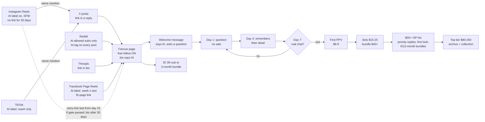

# Fanvue AI-persona playbook (written Mon 12 Oct 2026, alignment changes folded in)

The merged operating plan. Replaces the 30-day table in `FANVUE_PLAN_8OCT.md` §3 where they differ.
Character: `CHARACTER_BIBLE_A.md`. Copy: `COPY_PACK.md`. Evidence: `MARKET_RESEARCH_2026-10-12.md`.
Changes from: `ALIGNMENT_2026-10-12.md` (gates, order, links, formats, expectations) and `IDENTITY_TEST_2026-10-12.md` (face lock).
Status: **plan only. Persona not picked. Nothing created, posted or sent.**
[E] = estimate. Calendar: day 0 = Mon 12 Oct.

**Changed 16 Oct** (evidence: `COACH_VIDEOS_2026-10-16.md` + community pass 16 Oct)
- Price: new **$80-$250 top tier** (VIP list only). **Trials de-prioritised**; the 3-month bundle is the default offer.
- **Facebook Page Reels = required week-1 test** with its own `fb-page` link and log column (was an optional week-2 test).
- **IG story link = test from Mon 2 Nov** (live day 15) if the day-14 gate passed and Account Status is clean. Bio and posts stay link-free to Wed 18 Nov.
- Scale phase: **2 Reels a day (1 new + 1 Trial variant)**; any Reel at 10K+ views gets 3-5 Trial variants. Format reads at 72 h.
- Metrics: coach benchmark lines added (§8). Day-14 audience check adds 85%+ male.

---

## 1. One-page summary

| Item | Decision |
|---|---|
| **Launch** | **Fanvue live + first public posts by Mon 19 Oct. If not live by then, stop the plan.** |
| Persona | A1 recommended: Nadia Vale, 39, silver streak (swap block in bible/copy for B or C) |
| Disclosure | Openly AI everywhere: bios, IG label, TikTok label, Reddit AI tag, welcome message, every "are you real?" |
| Build order | **Chat + paid-message ladder + Day 1/3/7 messages first.** Then a small backlog: **14 Reels + 20 photos.** |
| Money comes from | Paid messages / PPV (60 to 70%), not the subscription |
| Fanvue link | **X (in a reply) + Reddit (AI-allowed subs only) from launch day.** Threads bio too. **Facebook Page from launch (week-1 test).** **Instagram bio and posts link-free for 30 days (to Wed 18 Nov).** Plain story link: test from Mon 2 Nov only if the day-14 gate passed and Account Status is clean. |
| Reach formats | **"With her" POV for men 35 to 54** (US + UK). At most 1 in 4 Reels as advice or roast. |
| Face lock | **Reference-edit model** from the approved A1 image. Text-only and style-reference routes do not hold the face. |
| Not used | YouTube (link bans). TikTok = reach only, no link. |
| Facebook | **Required week-1 test:** every IG Reel also goes to a Facebook Page, same day, own `fb-page` tracking link (§5) |
| Price | Free follow on, $7.99 sub, **3-month bundle 20 to 30% off = default offer**, no trial links at launch. PPV $6 to $9 → $15 to $25 → $40+ → **$80 to $250 top tier (VIP list only)** |
| Chat | 2 fixed inbox windows a day + VIP notifications |
| Content cost | about $23/month WaveSpeed (≈ £17) + Fanvue 20% (15% first 30 days) |
| His time | 8 to 10 h in setup week, then about 10 h/week |
| Gates | Day 14 (Mon 26 Oct): 40+ link clicks + 1+ paying fan. Day 30 (Wed 11 Nov): 10+ paying fans or £75+ net, else stop or hold. |
| Honest expectation | Mid case about **£35 / £145 / £315 net** per month at day 30 / 60 / 90 (§7). Cash lags 7 to 28 days. |

---

## 2. Honest expectation (from `ALIGNMENT_2026-10-12.md` §1)

| Case | Chance | Paying fans day 30 / 60 / 90 | **£/month net, day 30** | **day 60** | **day 90** |
|---|---|---|---|---|---|
| Low | 55% | 0 / 3 / 6 | £0 | £25 | £50 |
| Mid | 35% | 2 / 12 / 25 | £20 | £120 | £250 |
| High | 10% | 15 / 50 / 110 | £270 | £900 | £2,000 |
| **Expected value** | | | **about £35** | **about £145** | **about £315** |

| Fact | Number |
|---|---|
| Cash in the bank at day 30 (low and mid) | about £0. Fanvue holds payouts **7 to 28 days**; first withdrawal is reviewed by hand. |
| Chance of £2,000+/month run-rate by day 90 | about 5% |
| Chance of £2,000+/month by June 2027 | about 10 to 15% |
| His £/hour during the ramp, mid case | about £3 |
| Why run it anyway | The option on months 4 to 12. The gates decide fast whether to hold it. |
| Withdraw | The first $20 as soon as it exists |

---

## 3. Funnel

| Stage | Number to watch | Benchmark |
|---|---|---|
| Reddit click → sub (mature niche) | tracking-link subs | 8 to 12% [V, one source] |
| Reel views → paying fan | tracking-link subs | 10 to 20 per 100k views [F] |
| Sub → first PPV in 7 days | % of new subs | 10 to 20% solid, 30 to 60% top |
| Spend timing | first 48 h | 83% of payments land here |

---

## 4. Build order (chat first, then content)

| # | By | Step | Who |
|---|---|---|---|
| 1 | Tue 13 Oct | Pick persona A / B / C; agree launch date Mon 19 Oct | **Him** |
| 2 | Fri 16 Oct | Fanvue sign-up, KYC, tax, bank, mark account as AI | **Him** |
| 3 | Fri 16 Oct | **Chat engine:** welcome automation, Day 1/3/7 messages, Creator Personality file, two inbox windows set, Fan Notes habit (`COPY_PACK.md` §4 to §6) | Assistant writes, he pastes |
| 4 | Fri 16 Oct | **Paid-message ladder:** $7.99 sub, 3-month bundle as the default offer (no trial links at launch), tracking links incl. `fb-page`, 5 PPV set listings + 1 top-tier listing ($80-$250) | Assistant writes, he sets |
| 5 | Sat 17 Oct | 5 paid PPV sets made on his own tool, matching the face | **Him** |
| 6 | Thu 15 Oct | **Identity set: 20 to 30 images via reference-edit** (Nano Banana 2.1 Edit; A/B Seedream 5.0 Flash Edit on 3 scenes, keep whichever holds the face). Never text-only or soul_2 style-ref. | Assistant, his yes on the face |
| 7 | Thu 15 Oct | Independent QC agent checks every image: same face 10/10, reads 35+, streak present | Agent |
| 8 | Sat 17 Oct | **Backlog: 14 Reels + 20 photos**, AI-labelled | Assistant |
| 9 | Sun 18 Oct | Accounts: IG (AI label), X, Threads, TikTok, Reddit; 20 Fanvue wall posts up | **Him** |
| 10 | **Mon 19 Oct** | **Launch.** First posts on X, Reddit, IG. Fanvue live. | Both |
| later | after 15-25 approved images | LoRA (~$2.50), A/B against ref-edit, keep the winner | Assistant |

- Pipeline age guard already accepts 25-45, so age 39 runs as is.
- Every prompt states age 39 and "fine laugh lines, natural skin texture". Generators pull faces younger.
- Keep WaveSpeed generation logs per batch as provenance (Fanvue withholds earnings for face-swapped or real-photo content).

---

## 5. Platform roles

| Platform | Role | Link | Must do |
|---|---|---|---|
| X | **Link engine #1, from launch** | `x-bio` + link in a **reply** under 1 in 3 posts | Label any adult media; never adult avatar/header |
| Reddit | **Link engine #2, from launch** | `reddit-` tracking link per subreddit | **Only subreddits that allow AI.** AI tag on every post. Never the same link in many subs. Read each sub's rules first. |
| Instagram | **Reach engine.** Reels + stories. | **Bio and posts: none for 30 days after launch (to Wed 18 Nov).** **Story-link test from Mon 2 Nov (live day 15)**, only if the day-14 gate passed and Account Status is clean: plain `ig-story` link in 1 story a day, never cloaked, never highlights. "Not recommended" = remove that day. | "AI-generated profile" on before post 1. Check Account Status weekly. |
| Threads | Cross-post, low effort | `threads-bio` | Conversational captions |
| TikTok | Reach only | None | AI label on every post with her in it |
| Fanvue | Where money happens | — | 20 wall posts before launch. Bio says AI. |
| Facebook Page | **Required week-1 test (from Mon 19 Oct).** Every IG Reel posted natively to the Page, same day, same clean `.mp4` and caption | `fb-page` tracking link in the Page intro/website field only, never in captions | AI label on each Reel; Page bio says AI. Created from his real personal profile (Meta rule). Log FB Reel views separately. Day-14 read: if FB reach ≥ IG, keep; if the Page gets any restriction, stop it the same day |
| YouTube | **No** | — | Channel terminations for sexual-content links (Jul 2026) |

- Audience target: **men 35 to 54, US + UK.** Day-14 check: 40%+ US/UK/CA/AU, 50%+ men 25 to 54, **85%+ male**.
- Posting window: **UK 19:00 to 22:00** (= US East 14:00 to 17:00). Clocks: UK changes 25 Oct, US 1 Nov.

---

## 6. Content

### Lead formats: "with her" POV (at least 3 in 4 Reels)

| Format | Example hook (SFW) |
|---|---|
| Cosy gaming night | "POV: co-op night at mine. You're carrying. I'm 'helping'." |
| Cooking for you | "POV: I'm cooking for you and you said you don't eat pasta." |
| Date-night outfit check | "Black knit or green silk? You pick, we're late." |
| Evening wine and chat | "POV: second glass, rain on the window, tell me about your day." |
| London walk | "Walk with me to the wine bar. Camel coat weather." |
| Advice / roast (max 1 in 4) | "One thing men over 35 still get wrong on a first date." |

### Cadence

| Platform | Test phase: 19 Oct to 1 Nov | Scale phase: 2 Nov to 3 Dec |
|---|---|---|
| Instagram Reels | 1 a day (2 at weekends), 3 POV formats rotated | **2 a day: 1 new + 1 Trial Reel variant**; winning format ≥ 4 a week. **Any Reel at 10K+ views → 3 to 5 Trial variants, one change each** (outfit colour, timing, opening frame); about $0.22 each. Judge at 72 h |
| Facebook Page Reels | Every IG Reel, same day (week-1 test) | Keep if day-14 FB reach ≥ IG; else drop |
| Instagram stories | 3 a day | 3 a day; **story-link test from Mon 2 Nov** if the day-14 gate passed (1 linked story a day) |
| X | 2 to 3 posts a day; link reply on 1 in 3 | 3 a day |
| Reddit | 1 post a day across AI-allowed subs; never repeat a sub inside 3 days | 1 to 2 a day in the subs that brought subs |
| Threads | 1 to 2 a day | 2 a day |
| TikTok | 1 a day | 1 a day |
| Fanvue wall | 20 before launch, then 1 a day | 1 a day; new PPV set weekly |

| Backlog | Pre-launch | Monthly after |
|---|---|---|
| Reels | 14 | 20 to 30 new + up to 30 Trial variants |
| Photos | 20 | 60 |
| His approval time | about 40 min | about 1.5 to 2 h |

---

## 7. Chat windows

| Window | Time (UK) | Length | What |
|---|---|---|---|
| Before work | 07:00 | about 20 min | $50+ list first, then new subs, then the rest |
| After work | 19:00 to 20:00 | about 20 to 30 min | Same order. Day 1/3/7 messages. PPV offers. |
| VIP | Phone notifications | As they come | $50+ list only |
| Weekly | Sunday | 20 min | Review a sample of AI-drafted chats; update Fan Notes; log £ per chat hour |

| Who writes what | |
|---|---|
| AI may send (spot-checked) | Thank-yous, light check-ins |
| AI drafts, person reviews | First message to a new sub, every PPV pitch, anything to $50+ |
| Person only | "Are you real?", customs, complaints, refunds, a fan in distress |

- Every new fan answered inside 24 h (target: hours). Over 48 h costs revenue.
- Fanvue's own AI Messaging only. No outside tools, no pasting chats elsewhere.

---

## 8. Metrics and gates

### Sheet (he enters Fanvue numbers twice a week, 5 min)

| Metric | Type | Where |
|---|---|---|
| Median Reel views, sends per reach | Leading | IG Insights |
| Tracking-link clicks, per link | Leading | Fanvue |
| Free follows | Leading | Fanvue |
| **New paying fans, per tracking link** | **Decides** | Fanvue |
| Net per paying fan, £ per chat hour | Money | Fanvue + log |
| Inbox windows kept (days) | Ops | Log |
| IG Account Status, audience country/age/gender | Risk | IG |
| FB Page Reel views, `fb-page` clicks and paying fans | Leading / decides | FB + Fanvue |

| Coach benchmark lines (V3, unverified; replace with our own 30-day median once we have one) | Line |
|---|---|
| Non-follower share of reach | 60% |
| Saves per 1K reach | 10+ |
| Shares (sends) per 1K reach | 5+ |
| Profile visits per 1K reach | 20 to 40 |
| Follows per profile visit | 8 to 15% |

### Day 7: Mon 19 Oct (execution gate)

| Result | Action |
|---|---|
| Fanvue verified + marked AI, 20 wall posts, PPV ladder set, first posts live on X, Reddit and IG | Continue |
| **Not live** | **Stop the plan.** Move the hours elsewhere. |

### Day 14: Mon 26 Oct (about 7 days live)

| Result | Action |
|---|---|
| **40+ tracking-link clicks AND 1+ paying fan** (plus 10+ Reels, 15+ X/Reddit posts, median Reel 300+ views or one 3,000+, 5+ free follows) | **Continue** |
| Reach passes, clicks under 40 | Fix one thing: link placement or call to action. Re-check day 21 (Mon 2 Nov). |
| Clicks 40+, 0 follows | Fix one thing: Fanvue page, price or bundle offer. Re-check day 21. |
| Median Reel under 200 views AND X/Reddit under 20 clicks | **Stop**, or one last format change, hard re-check day 21 |
| IG flagged "not recommended" AND X/Reddit under 20 clicks | **Stop** |

### Day 30: Wed 11 Nov (about 23 days live)

| Result | Action |
|---|---|
| **10+ paying fans, or £75+ net in days 15 to 30**, AND £10+ net per chat hour | **Continue.** Add one content day a week. Test $12.99 sub (one change). |
| 3 to 9 paying fans AND 100+ link clicks a week | **Hold** to day 60 at the same hours. No new hours, no paid tools. |
| Under 3 paying fans AND under 300 followers | **Stop.** Cancel paid tools. |
| 300+ clicks but under 3 paying fans | **Stop.** Funnel broken. |
| Inbox windows kept on under half of days | **Stop.** Chat carries the money. |

### Day 60: Fri 11 Dec (hard check)

| Result | Action |
|---|---|
| £200+/month net run-rate, or 25+ paying fans | Continue to the 6-month review (mid-April 2027) |
| Below that | **Stop.** |

---

## 9. Money

### Weekly budget

| Line | Per week | Per month | Note |
|---|---|---|---|
| WaveSpeed stack | about $6 (£4.30) | about $23 (£17) | `pipeline/MODELS.md` §7. Code caps: $2 per run, $100 per month. Nano Banana edits (~$0.07) add about £2/month if they win the A/B. |
| After LoRA wins | about $3 | about $12 | photos drop to $0.01 each |
| Fanvue fee | — | 15% of sales first 30 days after KYC, then 20% | VAT added on top for the fan |
| Scheduler | £0 to £3.50 | £0 to £15 | One already connected |
| Paid shoutouts | £0 | £0 | Not before day 30; then a £30 test only if net per fan is £15+ |
| Chatters | £0 | £0 | Not before £1,000/month gross |
| **Total fixed** | **about £4 to £8** | **about £17 to £32** | |

### What £2,000/month net takes [E]

| Gross per paying fan / month | Net (−20%, £1 = $1.33) | Paying fans for £2,000 + £17 tools | Gross needed |
|---|---|---|---|
| $18 | £10.83 | **187** | $3,370 |
| **$20** | **£12.03** | **168** | **$3,360** |
| $22 | £13.23 | **153** | $3,370 |

| Holding 168 paying fans | Churn 25% | Churn 40% |
|---|---|---|
| New paying fans per month | 42 | 67 |
| Reel views per month at 10 to 20 per 100k | 0.21M to 0.42M | 0.34M to 0.67M |
| Average views per Reel at 2 a day | 3,500 to 7,000 | 5,600 to 11,000 |
| Chat hours at that size | 15 to 20 a week. That is the point to add a chatter. | |

---

## 10. His hands

- [ ] 🎯🧭🖊️🌀🦊 **Pick the persona (A, B or C) and check the handles are free.**

- [ ] 🗓️🚦📣🧲🌙 **Agree the launch: live by Mon 19 Oct, or the plan stops.**

- [ ] 🪪🏦📸🧷🧾 **Fanvue: sign up, ID + selfie, tax interview, bank details, mark the account as AI. By Fri 16 Oct.**

- [ ] 🎬🗂️🔒🧪🍷 **Make 5 paid PPV sets on your own tool, matching the face, and upload them. By Sat 17 Oct.**

- [ ] 📱🏷️🧩🚪🐈 **Create IG, X, Threads, TikTok, Reddit + a Facebook Page (from your own profile) with AI labels on, display name `Nadia Vale · AI`. By Sun 18 Oct.**

- [ ] 🔑📁🛡️🧯⚙️ **Create `~/Bernard/ofm/.env` with `WAVESPEED_API_KEY=...` yourself. Never paste it in chat.**

Also his:
- [ ] Final yes on the face (identity set)
- [ ] Publish clicks where scheduling isn't possible (X, Reddit, IG)
- [ ] Sending messages (Fanvue drafts, he sends), and every "are you real?" answer
- [ ] Price changes and the day 7 / 14 / 30 / 60 calls
- [ ] Fanvue numbers into the sheet twice a week

## Affiliate + "insinuating review" pillar (owner decision 16 Oct)

| Phase | Instagram / TikTok / Threads / Facebook | X / Reddit |
|---|---|---|
| Weeks 1-4 | SFW product Reels with innuendo (wine, kitchen gadgets, candles, silk robes, perfume, gaming chairs). Bio link = affiliate storefront (Amazon Storefront / LTK). No Fanvue link. | Owner runs these (NSFW, with Grok). Fanvue link from day 1. |
| Week 5+ (after socials established) | Fanvue link added (story link first, then bio) | unchanged |

**Script rules (UK fake-review ban, DMCC Act 2024 + ASA/CAP; FTC in the US):**
- Nadia is AI, so she **can't claim she used or tested a product**. Frame it as "Nadia's picks", "would you get me this?", "rate my choice": opinion and style, not a testimonial.
- **#ad** (or "affiliate link") on every post with an affiliate link, plus the platform's paid-partnership tag where it exists. The AI label stays on.
- Innuendo stays suggestive, not sexual. No sex-toy products on Instagram/TikTok (that's X/Reddit's lane).
- Products only from programmes that allow AI creators. Check each programme's terms (Amazon Associates requires clear disclosure).

**Formats:** "POV: you bought me this", "3 things in my kitchen men always ask about", "rate my Friday night: 1-10", "the candle that makes him stay over", "unboxing what he sent me" (no claims that it works).
**Track:** affiliate clicks per 1k views (storefront dashboard) alongside follows and sends.
