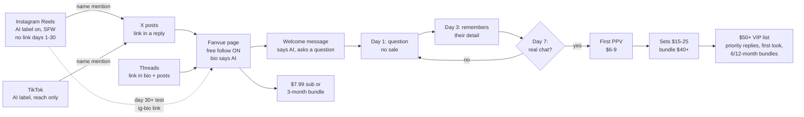

# Fanvue AI-persona playbook (written Mon 12 Oct 2026)

The merged operating plan. Replaces the 30-day table in `FANVUE_PLAN_8OCT.md` §3 where they differ.
Character: `CHARACTER_BIBLE_A.md`. Copy: `COPY_PACK.md`. Evidence: `MARKET_RESEARCH_2026-10-12.md`. Pipeline: `pipeline/README.md`.
Status: **plan only. Persona not picked. Nothing created, posted or sent.**
[E] = estimate.

---

## 1. One-page summary

| Item | Decision |
|---|---|
| Persona | A1 recommended: Nadia Vale, 39, silver streak (swap block in bible/copy for B or C) |
| Disclosure | Openly AI everywhere: bios, IG label, TikTok label, welcome message, every "are you real?" |
| Money comes from | Paid messages / PPV (60 to 70%), not the subscription |
| Traffic engines | Instagram Reels (reach, no link at first) + X (link in a reply) + Threads (link allowed) |
| Not used | YouTube (link bans, Jul 2026 terminations). TikTok = reach only, no link. |
| Price | Free follow on, $7.99 sub, 3-month bundle 20 to 30% off, PPV $6 to $9 → $15 to $25 → $40+ |
| Chat | 2 fixed inbox windows a day + VIP notifications. Day 1 / 3 / 7 schedule. |
| Content cost | about $23/month WaveSpeed (≈ £17) + Fanvue 20% (15% first 30 days) |
| His time | Setup 4 to 6 h in week 1. Then 6 to 12 h/week, mostly chat. |
| Target | £2,000/month net ≈ **155 to 175 paying subs** at $20 to $22 each |
| Realistic timing [E] | Months 1 to 3: £0 to £250. £2k/month is a month 6 to 9+ outcome, about 10 to 15% chance by Jun 2027. |
| Gates | Day 14: pick the winning format. Day 30: continue / hold / stop. |
| Blocker before images | Pipeline age guard only allows 25-30 (see §8) |

---

## 2. Funnel

| Stage | Number to watch | Benchmark |
|---|---|---|
| Reach → follow | sends per reach, follows per Reel | 0.27% view-to-follow (one measured AI Reel) |
| Views → Fanvue sub | tracking-link subs | 10 to 20 per 100k Reel views [F] |
| Sub → first PPV in 7 days | % of new subs | 10 to 20% solid, 30 to 60% top |
| Sub → ever pays | % | 4.2% average |
| Spend timing | first 48 h | 83% of payments land here |

---

## 3. Platform roles

| Platform | Role | Link | Must do |
|---|---|---|---|
| Instagram | **Reach engine.** Reels + stories. Carousels build trust. | **None days 1 to 30.** Test `ig-bio` after, only if Account Status is clean. | "AI-generated profile" on before post 1. Original content only. |
| X | **Link engine #1** | `x-bio` + link in a **reply** under 1 in 3 posts | Mark any adult media; never adult avatar/header |
| Threads | **Link engine #2**, low effort | `threads-bio`, `threads-post` | Cross-post IG with conversational captions. Reply to others. |
| TikTok | Reach only | None | AI label on every post with her in it |
| Fanvue | Where money happens | — | 20 wall posts live before any promo. Bio says AI. |
| Facebook Page | Optional test after day 14 | Links allowed | One test, measured like the rest |
| Reddit | Only subreddits that allow AI | Per sub rules | Never the same link in many subs |
| YouTube | **No** | — | Channel terminations for sexual-content links (Jul 2026) |

- Aim posts at **US + UK adults**. Views from regions that don't buy don't convert.
- Posting window: **UK 19:00 to 22:00** (= US East 14:00 to 17:00). Clocks: UK changes 25 Oct, US 1 Nov; gap is 4 h that week.

---

## 4. Posting cadence

### Days 1 to 14: test (12 to 20 test posts across 3 formats)

| Platform | Per day | Formats rotated |
|---|---|---|
| Instagram Reels | 1 (2 on weekends) | **F1** blunt advice / roast · **F2** kitchen + wine POV · **F3** gaming-night story |
| Instagram stories | 3 | selfie, lifestyle, poll |
| Instagram carousel | 2 per week | "my week", outfits |
| X | 2 to 3 posts | photo + one-line opinion; link reply on 1 in 3 |
| Threads | 1 to 2 | cross-post + a question |
| TikTok | 1 | same Reel, AI label |
| Fanvue wall | 20 posts live **before day 1 of promo**, then 1 a day | SFW teasers |
| Fanvue PPV | 3 sets ready at launch | owner makes |

### Days 15 to 45: scale the winner

| Platform | Per day | Rule |
|---|---|---|
| Instagram Reels | 1 to 2 | **Winning format ≥ 4 times a week.** Retest winners as Trial Reels. |
| Instagram stories | 3 | Same |
| X | 3 | Winner's angle in text form |
| Threads | 2 | Same |
| TikTok | 1 | Same |
| Fanvue wall | 1 a day | New PPV set every week |
| Facebook Page | 1 (test) | Only if a free hour exists |

### Content needed per month

| Item | Volume | Pipeline cost |
|---|---|---|
| Photos (approved) | 60 | included in $23 |
| Reels (approved) | 20 to 30 | included in $23 (30 Reels ≈ +$3) |
| His approval time | 60 to 90 s per image | about 1.5 to 2 h/month |

---

## 5. Chat windows

| Window | Time (UK) | Length | What |
|---|---|---|---|
| Morning | 07:00 | 20 to 30 min | $50+ list first, then new subs, then the rest |
| Evening | 19:00 to 20:00 | 30 to 45 min | Same order. Day 1 / 3 / 7 messages. PPV offers. |
| VIP | Phone notifications | As they come | $50+ list only |
| Weekly | Sunday | 20 min | Review a sample of AI-drafted chats; update Fan Notes |

| Who writes what | |
|---|---|
| AI may send (spot-checked) | Thank-yous, light check-ins |
| AI drafts, person reviews | First message to a new sub, every PPV pitch, anything to $50+ |
| Person only | "Are you real?", customs, complaints, refunds, a fan in distress |

- Target: new subs answered within hours; everyone within 12 h. Over 48 h costs revenue (one report: −18%).
- Use Fanvue's own AI Messaging only. No outside tools, no pasting chats elsewhere.

---

## 6. Metrics and gates

### Weekly sheet (he enters Fanvue numbers twice a week, 5 min)

| Metric | Type | Where |
|---|---|---|
| Sends per reach, per Reel | Leading | IG Insights |
| Follows per Reel | Leading | IG Insights |
| Tracking-link clicks, per link | Leading | Fanvue |
| **New paying subs, per tracking link** | **Decides** | Fanvue |
| % new subs buying first PPV in 7 days | Money | Fanvue |
| Gross, net, per paying sub | Money | Fanvue |
| Median reply time | Ops | Fanvue |
| IG Account Status | Risk | IG settings |

### Target curve (from `FANVUE_PLAN_8OCT.md`)

| Week | Link clicks / week | New paying subs / week | Followers, all platforms |
|---|---|---|---|
| 1 | n/a | n/a | 0 |
| 2 | 40 | 1 | 150 |
| 3 | 100 | 3 | 500 |
| 4 | 150 | 5 | 1,000 |

### Day-14 gate (format)

| Result | Action |
|---|---|
| One format leads on sends per reach by ≥ 1.5x | Make it ≥ 4 a week from day 15. Drop the weakest format. |
| No clear leader | Keep all 3 for 7 more days. Change hooks, not the persona. |
| A tracking link has 0 clicks in 14 days | Check the link works. Then move effort to the other links. |
| Any IG restriction | Remove any link mention. Keep posting SFW. |

### Day-30 gate (continue / hold / stop), day 30 = 30 days after Fanvue goes live

| Result | Action |
|---|---|
| 10+ paying subs total, or £75+ gross in days 15 to 30 | **Continue.** Add a second batch day. Test $12.99 sub (one change). |
| 3 to 9 paying subs and 100+ link clicks a week | **Hold.** 30 more days at the same hours. No new spend. |
| Under 3 paying subs and under 300 followers | **Stop.** Cancel paid tools. Sunk cost about £20 to £60. |

---

## 7. Money

### Weekly budget

| Line | Per week | Per month | Note |
|---|---|---|---|
| WaveSpeed stack (60 photos + 20 Reels + LoRA) | about $6 (£4.30) | about $23 (£17) | `pipeline/MODELS.md` §7. Code caps: $2 per run, $100 per month. |
| After LoRA wins | about $3 | about $12 | photos drop to $0.01 each |
| Fanvue fee | — | 15% of sales first 30 days after KYC, then 20% | VAT is added on top for the fan; Fanvue pays it |
| Link hub | £0 | £0 | Only if used; 18+ notice |
| Scheduler | £0 to £3.50 | £0 to £15 | One already connected on this Mac |
| Higgsfield | — | £0 extra | Optional; the WaveSpeed pipeline replaces it |
| **Total fixed** | **about £4 to £8** | **about £17 to £32** | |

- Break-even [E]: 2 to 3 paying subs at $20.
- Cash timing: Fanvue holds money 7 to 28 days; first withdrawal is reviewed by hand.

### Revenue scenario to £2,000/month net [E]

| Gross per paying sub / month | Net to him (−20%, £1 = $1.33) | Paying subs for £2,000 + £17 tools | Gross needed |
|---|---|---|---|
| $18 | £10.83 | **187** | $3,370 |
| **$20** | **£12.03** | **168** | **$3,360** |
| $22 | £13.23 | **153** | $3,370 |

| Where the $20 comes from [E] | Per paying sub | Share |
|---|---|---|
| Subscription | $7.99 | 40% |
| PPV + paid messages | $10 | 50% |
| Tips + customs | $2 | 10% |

| Holding 168 paying subs | Low churn (25%) | High churn (40%) |
|---|---|---|
| New paying subs needed per month | 42 | 67 |
| Reel views per month at 10 to 20 subs / 100k [F] | 0.21M to 0.42M | 0.34M to 0.67M |
| Views to reach 168 the first time | 0.84M to 1.68M | same |

- Persona A's mature niche reports $20 to $25 subs and 8 to 12-month retention [V]. If that holds, the low-churn column applies.
- The one solo case on record: 150 paying subs = $2,500 to $4,000/month, "a few hours a day" (Fortune, self-reported).

---

## 8. Build order before launch

| # | Step | Who | Blocks |
|---|---|---|---|
| 1 | Pick persona A / B / C | **Him** | Everything |
| 2 | Widen pipeline age guard to an adult range that includes the persona (e.g. 25 to 45), keep every youth ban | Assistant | Character JSON |
| 3 | `characters/nadia.json` from bible §P2 and §P3 | Assistant | Master set |
| 4 | Master set → QC → pick refs (≈ $0.40) | Assistant, his yes on the face | Shoots |
| 5 | 20 to 30 identity images → LoRA ($2.50 to $5) | Assistant | Backlog |
| 6 | Backlog: 30 Reels + 60 photos, AI-labelled | Assistant | Socials |
| 7 | Quality-check agent reviews the actual images and Reels (face, streak, age read) | Independent agent | Launch |
| 8 | Accounts, KYC, paid content | **Him** | Launch |
| 9 | 20 Fanvue wall posts + 3 PPV sets live | **Him** (upload) | Promo |
| 10 | Day 1 of posting | Both | — |

---

## 9. His hands

- [ ] 🪪🏦📸🧷🧾 **Fanvue: sign up, pass ID + selfie (KYC), tax interview, bank details, mark the account as AI.**

- [ ] 📱🏷️🧩🚪🌙 **Create IG, X, Threads, TikTok accounts with the AI labels on, display name `Nadia Vale · AI`.**

- [ ] 🎬🗂️🔒🧪🍷 **Make the paid content with your own tools, matching the face lock, and upload it to Fanvue.**

- [ ] 🔑📁🛡️🧯⚙️ **Create `~/Bernard/ofm/.env` with `WAVESPEED_API_KEY=...` yourself. Never paste it in chat.**

- [ ] 🎯🧭🖊️🌀🦊 **Pick the persona (A, B or C) and check the handles are free.**

Also his:
- [ ] Final yes on the face (master set)
- [ ] Publish clicks where scheduling isn't possible
- [ ] Sending messages (Fanvue drafts, he sends), and every "are you real?" answer
- [ ] Price changes and the day-14 / day-30 calls
- [ ] Fanvue numbers into the sheet twice a week
